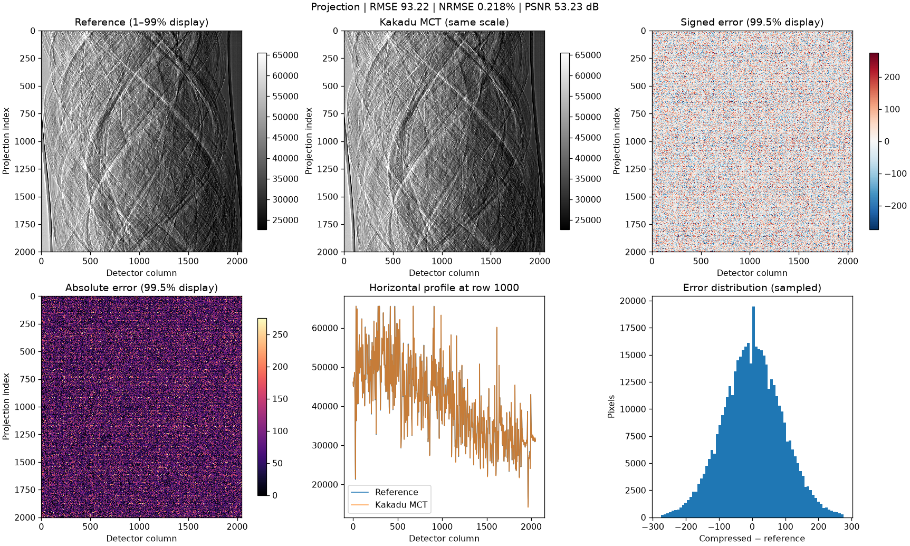
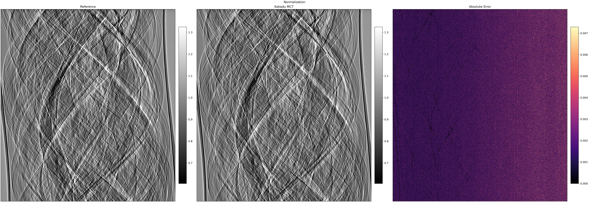
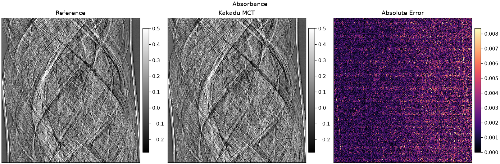
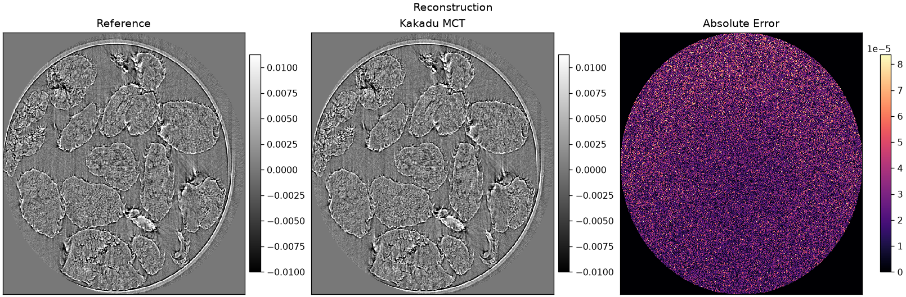

# Results

We compressed the original projections with Kakadu MCT
4x compression (the expected compression acceptable compression level according to Impact of lossy compression of X-ray projections onto reconstructed tomographic slices)

## Table

| Step           | RMSE     | MAE      | NRMSE | PSNR    |
| -------------- | -------- | -------- | ----- | ------- |
| Projection     | 93.2     | 72.9     | 0.22% | 53.2 dB |
| Normalization  | 0.0023   | 0.0017   | 0.31% | 50.1 dB |
| Absorbance     | 0.0025   | 0.0019   | 0.32% | 49.9 dB |
| Reconstruction | 0.000026 | 0.000018 | 0.12% | 58.5 dB |

Careful with PSNR comparison :

## Step by step grpahs

### Projection

### Normalization

### Absorbance

### Reconstruction

